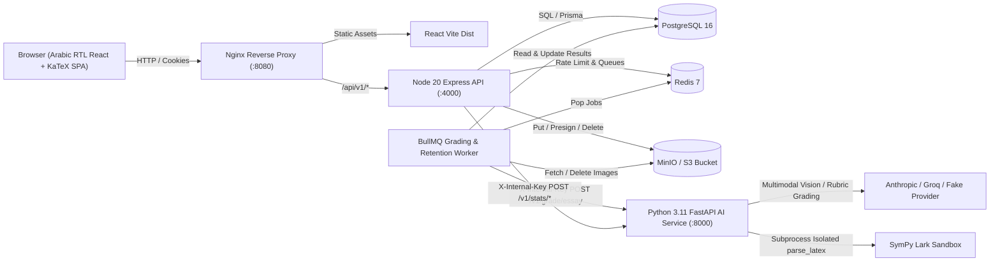
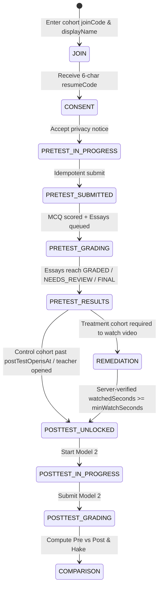
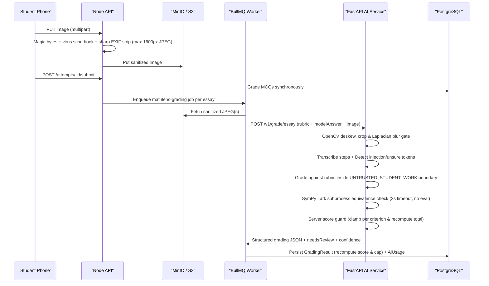

# MathLens System Architecture

## 1. Service Topology

## 2. Student Learning & Evaluation State Machine

## 3. Asynchronous Reference-Based Essay Grading Pipeline

## 4. Security, Privacy & Statistical Safeguards

- **Prompt Injection Defense**: Student handwriting is treated strictly as untrusted data wrapped in `<UNTRUSTED_STUDENT_WORK>...</UNTRUSTED_STUDENT_WORK>`, scanned for override phrases (`detect_prompt_injection`), and NEVER trusted to compute final numeric scores (`score_guard.py` + `GradingOrchestrator` recompute totals from clamped rubric criteria).
- **Eval-Free Math Parsing**: Student and teacher LaTeX expressions pass through `sympy.parsing.latex.parse_latex(..., backend="lark")` inside an isolated subprocess with a character whitelist and 3-second timeout (no Python `eval()`).
- **Minors Privacy & Retention**: Only a `displayName` and random unambiguous `resumeCode` are collected (no emails, phones, or analytics pixels for students). Uploaded images have EXIF/GPS metadata stripped via `sharp`, can be erased immediately via `DELETE /api/v1/student/data` or `DELETE /api/v1/cohorts/:id/data`, and non-pinned images older than `RETENTION_DAYS` after `FINAL` are purged nightly at 02:00 UTC by the BullMQ retention worker.
- **Anti-Cheat Video Gate**: `VideoService` merges client heartbeat playback intervals `[start, end]` on the server while rejecting forward seek jumps (`delta > 15s`), background tab intervals (`tabVisible=false`), and speeds above `1.5x`.
- **Statistical Engine & Export Safety**: `services/ai/app/routes_stats.py` computes paired tests (Shapiro-Wilk, paired _t_, Wilcoxon signed-rank, Cohen's _d_z_ + bootstrap 95% CI, Hake `<g>`, IQR outliers), between-group tests (Welch's _t_, Mann-Whitney _U_, Hedges' _g_ + CI, OLS Difference-in-Differences with student-clustered SEs), per-concept exact McNemar with Holm-Bonferroni correction, and AI reliability metrics. CSV/XLSX exports include UTF-8 BOM and neutralize leading formula characters (`=`, `+`, `-`, `@`, `\t`, `\r`).
